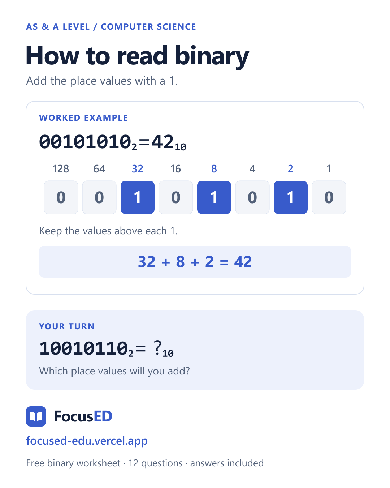

# How to read binary place values

An original FocusED mini-lesson for AS & A Level Computer Science.

Start on the right with 1. Double the place value each time you move left:

| Place value | 128 | 64 | 32 | 16 | 8 | 4 | 2 | 1 |
| --- | --- | --- | --- | --- | --- | --- | --- | --- |
| Binary digit | 0 | 0 | 1 | 0 | 1 | 0 | 1 | 0 |

Add only the place values with a 1: **32 + 8 + 2 = 42**. So **00101010₂ = 42₁₀**. Leading zeroes do not change the value.

Try **10010110₂** before opening the answer.

Check your working

The 1s are in the 128, 16, 4 and 2 columns. **128 + 16 + 4 + 2 = 150**, so **10010110₂ = 150₁₀**.

Practise with [the free FocusED binary worksheet](https://focused-edu.vercel.app/resources/a-level-computer-science-binary): two worked examples, twelve original questions, 24 marks and separate printable answers. No account is needed for that resource.

For more study tools, visit [FocusED](https://focused-edu.vercel.app/). The wider platform is freemium; this mini-lesson does not promise unlimited AI access or a complete official paper library.

This original resource is separate from any examination board's official papers. [Editable SVG](focused-binary-place-values.svg).
